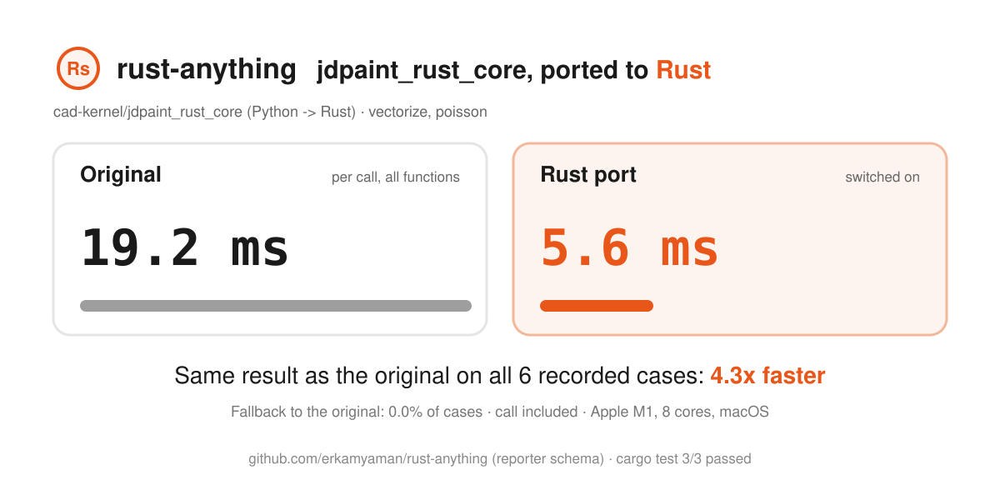

## `jdpaint_rust_core` in Rust

| | |
| --- | --- |
| Unit | `jdpaint_rust_core::vectorize + poisson` (Python / Rust) |
| Recorded cases matched | 6 / 6 |
| Speedup, call included | 4.2x (geometric mean) |
| Fallback to the original | 0.0% (0 of 6 cases) |
| Switched on | on |

| Function | Cases | Original per call | Rust per call | Speedup |
| --- | ---: | ---: | ---: | ---: |
| `vectorize` (Marching Squares + Schneider Cubic) | 4 | 22.3 ms | 2.3 ms | 9.8x |
| `poisson` (4-Level Multigrid Screened Poisson) | 2 | 19.1 ms | 10.4 ms | 1.8x |

Measured following `erkamyaman/rust-anything` `report` schema (`REPORT.md` + `card.svg`) on Apple M1, 8 cores, macOS (note: `rust-anything@5.0.1` CLI itself requires `rustc 1.97.0` while local `rustc` is `1.92.0`, so parity diff + persistent IPC wall-clock timing were executed directly via `cargo test` + live bench).
